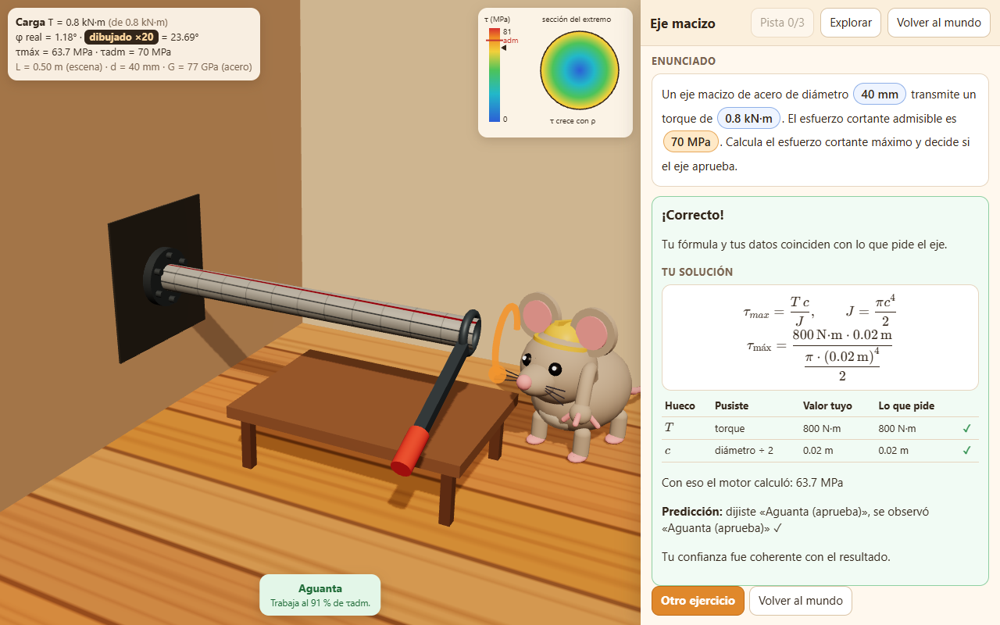

# Ratón Ingeniero

A 3D browser game that tutors mechanics of materials (torsion of shafts). You walk a mouse character around a small world, enter a module, and solve parametric engineering problems by dragging formulas and values, with no calculator. A deterministic engine grades every answer and tells you *which* conceptual mistake you made.



## What it actually does

- **Procedural exercises.** A JSON content pack defines formulas, variables and typical wrong formulas; a seeded generator produces concrete instances (21 variants across 5 modules in the torsion pack).
- **Error-aware judge.** Answers are checked with a 3 % relative tolerance; a wrong answer is compared against each "mistaken formula" to name the error (e.g. wrong polar moment) instead of just saying "incorrect".
- **Adaptive learner model.** Bayesian Knowledge Tracing per concept, a moving-average baseline, a next-exercise / help-level policy, and 1/3/7/21-day spaced review.
- **Safe expression interpreter.** Own parser for `+ - * / ^`, `pi` and variables; no `eval`.
- **Game layer.** three.js scene, Rapier character controller (walking, jump, coyote time, platforms, doors), touch controls, installable PWA.
- **First playable module:** "Eje macizo" (solid shaft). A second module ("Predecir el giro") is present in the world but locked.

## Stack

TypeScript (strict), Vite, three.js, Rapier (`@dimforge/rapier3d-compat`), KaTeX, zod, idb (IndexedDB event log), vite-plugin-pwa. Tests: Vitest (unit) and Playwright (e2e, desktop and phone viewports).

## Structure

```
src/engine/    pure TS tutor engine (units, expr, pack schema, generator, judge, learner/, log)
src/game/      world, mouse, camera, input, modules/ejeMacizo
src/ui/        HTML overlay: formula bank, drag & drop, KaTeX panel
contenido/     torsion.json content pack
tests/unit     engine tests     tests/e2e  gameplay + UI tests
docs/          PLAN.md (contracts), ESTADO.md (per-layer status)
```

## Run

```bash
npm install
npm run dev      # dev server
npm test         # unit tests
npm run e2e      # Playwright (builds and previews first)
npm run build
```

## Status (honest)

Prototype. Per `docs/ESTADO.md`: world, movement, platforms, engine and the solid-shaft module are implemented and were verified with unit and e2e tests on software WebGL. **Not verified:** real touch devices, 60 fps on a real GPU, offline PWA install, calibration of the adaptive thresholds with real learner data. Test results in this README were not re-run when preparing this repo.

The textbook PDF used as the content source is not included (copyright); the problems in the pack are original parametric variants.

UI text is in Spanish.
